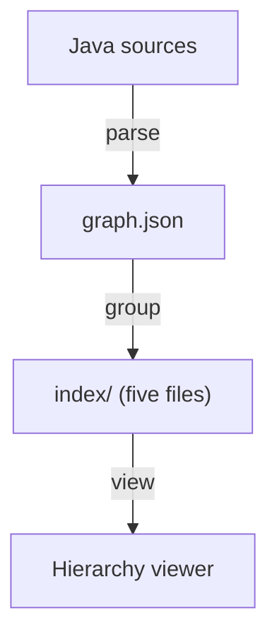

<p align="center">
  <video src="https://github.com/user-attachments/assets/2e56d9d5-70b9-4667-854f-718f852a8551" width="820" controls autoplay muted loop playsinline></video>
</p>

<h1 align="center">RepoHIVE</h1>

<p align="center">
  <b>Repository Hierarchical Indexing &amp; Visualization Engine</b><br>
  Find the hive inside your hairball.
</p>

<p align="center">
  <a href="LICENSE"></a>
  
  
</p>

---

A big codebase is thousands of files and tens of thousands of edges. Read flat, it is noise. RepoHIVE folds it into
**Repository, Groups, Files, Functions**, so a developer or an AI agent can start at the top and open only what matters.

## The idea

- **Keep what holds.** Most packages already say something true about the code. RepoHIVE scores each one and leaves
  the good ones alone.
- **Rebuild the rest.** A tangled package is regrouped by community detection on the real dependency graph.
- **Decide per region.** No single strategy is forced on the whole repository. Each region gets its own call.
- **Show the receipts.** Every score and every decision is written down. Same input, byte-identical output.

On **BroadleafCommerce** (2,985 files, 502 regions, signal from imports and shared types), RepoHIVE kept 38 of the 286
regions it could assess and rebuilt the other 248.

## Walk the layers

<p align="center">
  <video src="https://github.com/user-attachments/assets/4d192481-9513-4cb2-82a5-3f94f73b3b90" width="820" controls autoplay muted loop playsinline></video>
</p>

One ring per level. Pull the levels apart, stand one alone, turn it, and click a piece to follow its branch.

## Seven views of one index

<p align="center">
  <video src="https://github.com/user-attachments/assets/077845f3-83ef-4343-97b9-b232dde59115" width="820" controls autoplay muted loop playsinline></video>
</p>

| View | What it answers |
|------|-----------------|
| **Map** | What is inside each region, group and file? |
| **Decisions** | Which regions were kept, which were rebuilt, and where is the line? |
| **Hierarchy** | How is the whole repository nested? |
| **Architecture** | Which groups depend on which? |
| **Baseline** | What did the flat graph look like before any of this? |
| **Overview** | How big is it, and what are its largest regions? |
| **Adaptivity** | How do the region scores spread around the line? |

## How it works



1. **parse** reads Java sources into a flat dependency graph.
2. **group** scores every region, keeps or rebuilds it, and writes the index.
3. **view** opens that index as a navigable hierarchy.

## Quick start

Needs Node 24.

```bash
npm ci
npm run build
npm run parse -- fixtures/sample-java-project
npm run group -- fixtures/sample-java-project
```

`npm run group -- --help` lists the tuning options. The viewer is a Next.js app in `packages/web`; its README covers
running it locally.

## Repository

| Path | What lives there |
|------|------------------|
| `packages/parser` | Java sources to `graph.json` |
| `packages/core` | Scoring, the keep or rebuild decision, the index |
| `packages/views` | Builds each view from an index |
| `packages/design` | Tokens, components and screens |
| `packages/web` | The app that hosts the viewer |
| `docs/engineering` | Architecture, conventions, stack and verification |

## License

**GNU Affero General Public License v3.0 or later.** See [`LICENSE`](LICENSE).

Previously distributed under the MIT License; copies obtained under those terms remain under them.
